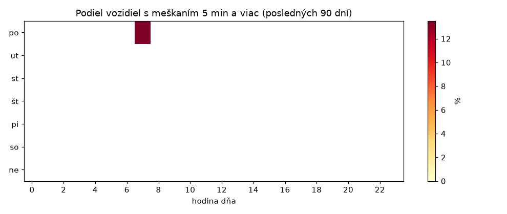
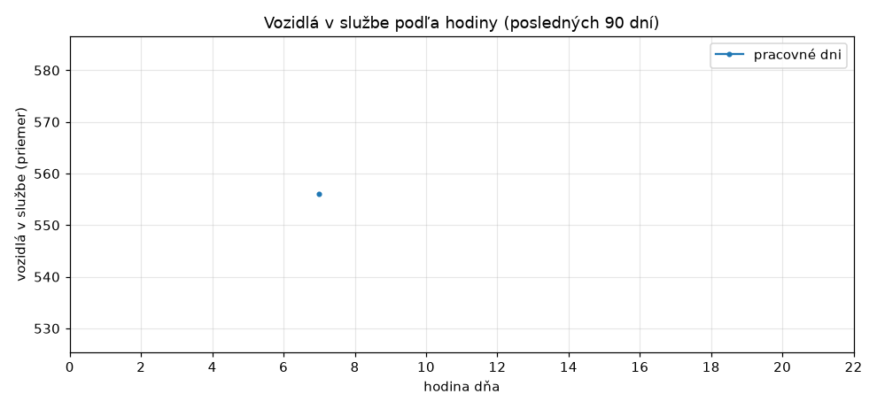
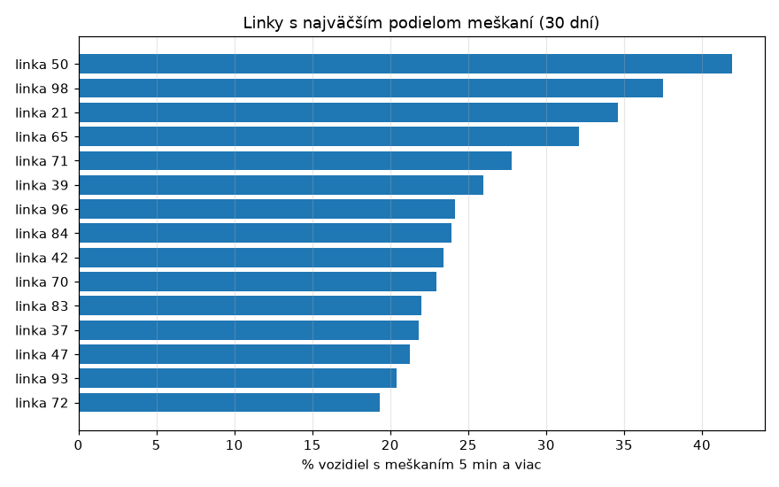
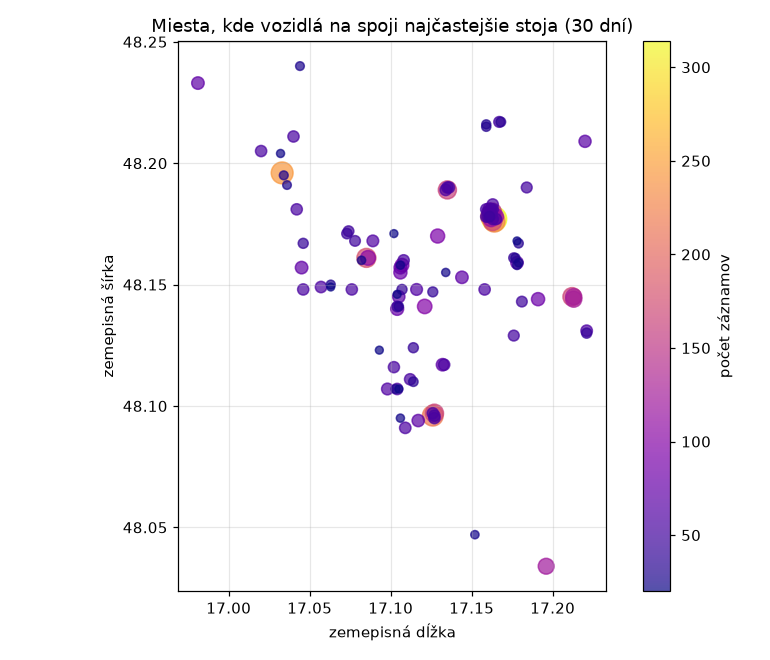

# Štatistiky MHD Bratislava

Automaticky generované 2026-10-27 01:10. Zdroj: kdejemhd.sk, zber každú minútu.

- Dní v štatistike: **1** (2026-10-26 až 2026-10-26)
- Priemerné pokrytie zberom: **4 %** (100 % = zber každú minútu celý deň)
- Posledných 7 dní: načas 42.1 %, meškanie 5 min a viac 20.6 %, v službe priemerne 561 vozidiel (31 440 meraní).

## Kedy meškajú najviac

## Linky s najväčším podielom meškaní (30 dní)

| Linka | Meraní | Načas % | 5 min+ % | Priem. meškanie (min) |
|---|---|---|---|---|
| 50 | 680 | 29.7 | 41.9 | 5.8 |
| 98 | 986 | 34.2 | 37.5 | 5.1 |
| 21 | 1139 | 37.2 | 34.6 | 4.3 |
| 65 | 966 | 23.1 | 32.1 | 4.5 |
| 71 | 896 | 30.9 | 27.8 | 3.4 |
| 39 | 527 | 50.9 | 26.0 | 3.5 |
| 96 | 783 | 35.0 | 24.1 | 2.7 |
| 84 | 1003 | 29.6 | 23.9 | 3.9 |
| 42 | 952 | 40.8 | 23.4 | 2.6 |
| 70 | 627 | 43.1 | 23.0 | 3.2 |

## Podľa typu vozidla (30 dní)

| Typ | Meraní | Načas % | 5 min+ % |
|---|---|---|---|
| Autobusy | 19449 | 39.0 | 24.4 |
| Tramvaje | 6174 | 48.8 | 9.4 |
| Trolejbusy | 5817 | 45.0 | 20.2 |

## Miesta, kde vozidlá stoja

Zahŕňa aj konečné a zastávky, kde vozidlá stoja prirodzene.

## Dáta na stiahnutie

Denné agregáty vo formáte CSV (zostávajú v repozitári natrvalo):

- [daily.csv](data/daily.csv) celkové údaje po dňoch
- [daily_route.csv](data/daily_route.csv) po linkách
- [daily_hour.csv](data/daily_hour.csv) po hodinách
- [daily_type.csv](data/daily_type.csv) po type vozidla
- [daily_hotspots.csv](data/daily_hotspots.csv) miesta, kde vozidlá stoja

## Poznámky k metodike

- Meškanie zdroj udáva v celých minútach. Hodnota 15:00 vyzerá ako strop, takže priemerné meškanie je orezané a presnejšie sú podiely. Stĺpec `pct_cap15` v CSV ukazuje podiel hodnôt na strope.
- „Načas“ je meškanie pod 1 minútu, „5 min a viac“ zodpovedá kategórii „nad 5 min“ na webe.
- Do štatistík meškaní sa počítajú len vozidlá, ktoré majú údaj o meškaní (sú na spoji).
- Dni sa počítajú v čase Europe/Bratislava. Pokrytie pod 100 % znamená výpadky zberu.
- Nezávislý projekt, nie je súčasťou Dopravného podniku Bratislava.
