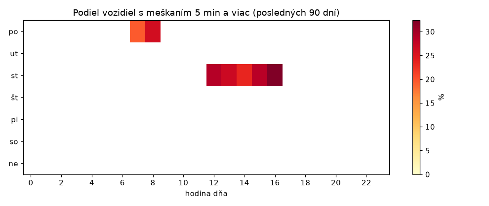
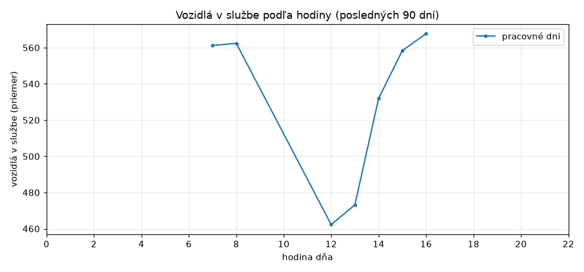
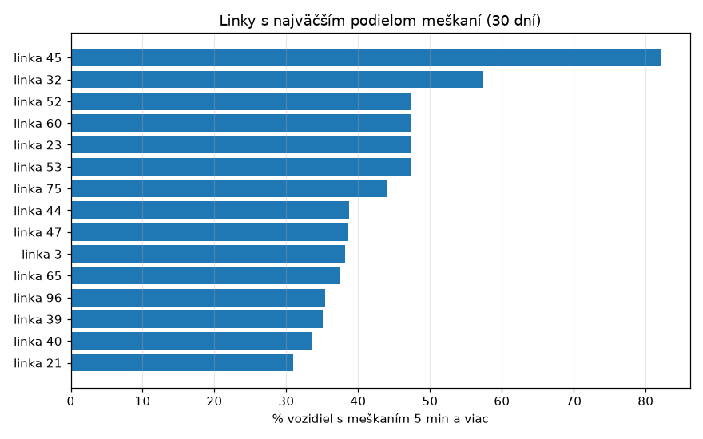
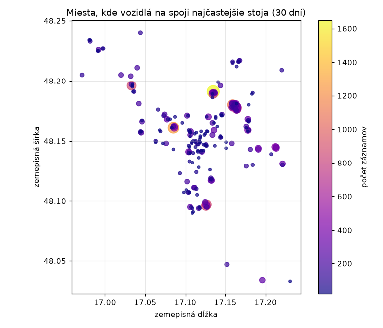

# Štatistiky MHD Bratislava

Automaticky generované 2026-11-27 21:10. Zdroj: kdejemhd.sk, zber každú minútu.

- Dní v štatistike: **2** (2026-10-26 až 2026-11-11)
- Priemerné pokrytie zberom: **9 %** (100 % = zber každú minútu celý deň)

## Kedy meškajú najviac

## Linky s najväčším podielom meškaní (30 dní)

| Linka | Meraní | Načas % | 5 min+ % | Priem. meškanie (min) |
|---|---|---|---|---|
| 45 | 779 | 14.0 | 82.0 | 12.3 |
| 32 | 1116 | 31.5 | 57.3 | 7.8 |
| 52 | 506 | 25.3 | 47.4 | 7.0 |
| 60 | 1896 | 32.5 | 47.4 | 7.2 |
| 23 | 1317 | 32.2 | 47.4 | 7.3 |
| 53 | 1271 | 29.2 | 47.3 | 6.6 |
| 75 | 1438 | 21.5 | 44.0 | 6.6 |
| 44 | 2189 | 32.4 | 38.7 | 5.3 |
| 47 | 2189 | 34.1 | 38.5 | 5.5 |
| 3 | 8274 | 33.5 | 38.2 | 6.1 |

## Podľa typu vozidla (30 dní)

| Typ | Meraní | Načas % | 5 min+ % |
|---|---|---|---|
| Autobusy | 63325 | 41.7 | 24.6 |
| Tramvaje | 20332 | 40.8 | 27.8 |
| Trolejbusy | 19589 | 38.3 | 31.8 |

## Miesta, kde vozidlá stoja

Zahŕňa aj konečné a zastávky, kde vozidlá stoja prirodzene.

## Dáta na stiahnutie

Denné agregáty vo formáte CSV (zostávajú v repozitári natrvalo):

- [daily.csv](data/daily.csv) celkové údaje po dňoch
- [daily_route.csv](data/daily_route.csv) po linkách
- [daily_hour.csv](data/daily_hour.csv) po hodinách
- [daily_type.csv](data/daily_type.csv) po type vozidla
- [daily_hotspots.csv](data/daily_hotspots.csv) miesta, kde vozidlá stoja

## Poznámky k metodike

- Meškanie zdroj udáva v celých minútach. Hodnota 15:00 vyzerá ako strop, takže priemerné meškanie je orezané a presnejšie sú podiely. Stĺpec `pct_cap15` v CSV ukazuje podiel hodnôt na strope.
- „Načas“ je meškanie pod 1 minútu, „5 min a viac“ zodpovedá kategórii „nad 5 min“ na webe.
- Do štatistík meškaní sa počítajú len vozidlá, ktoré majú údaj o meškaní (sú na spoji).
- Dni sa počítajú v čase Europe/Bratislava. Pokrytie pod 100 % znamená výpadky zberu.
- Nezávislý projekt, nie je súčasťou Dopravného podniku Bratislava.
