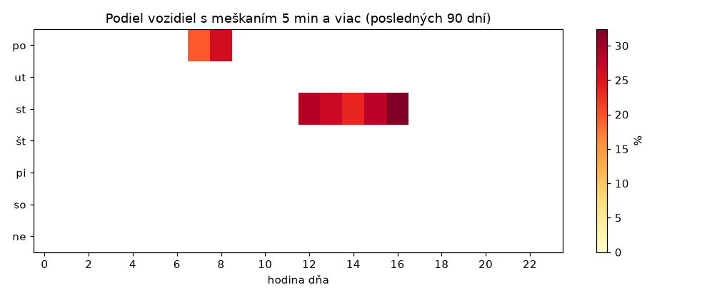
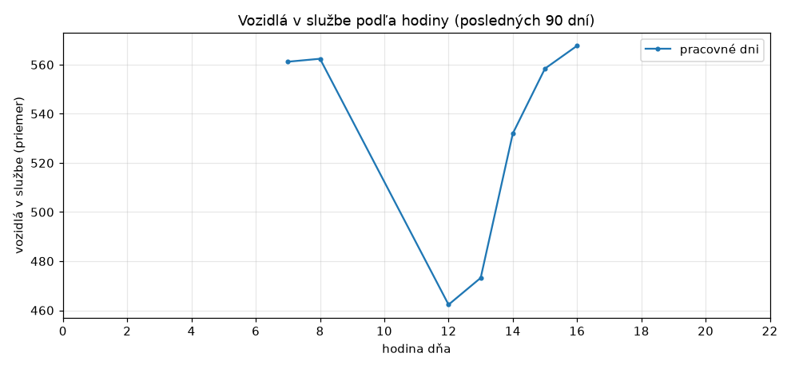
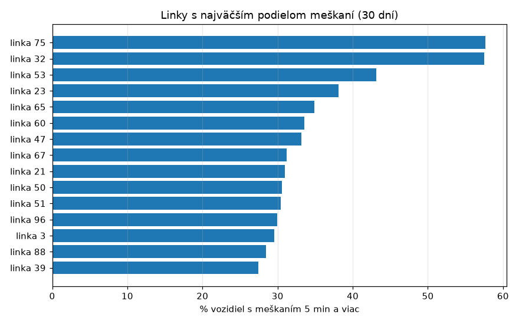
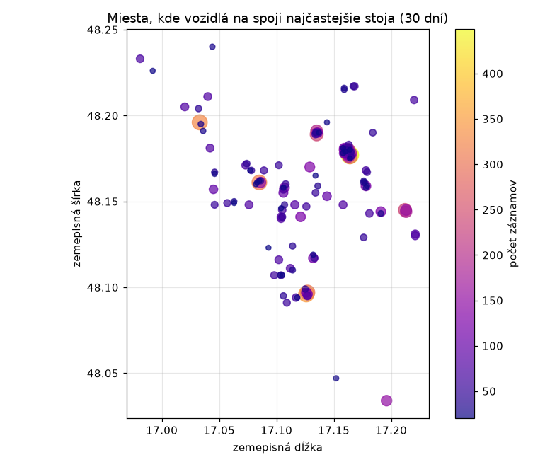

# Štatistiky MHD Bratislava

Automaticky generované 2026-11-14 17:10. Zdroj: kdejemhd.sk, zber každú minútu.

- Dní v štatistike: **2** (2026-10-26 až 2026-11-11)
- Priemerné pokrytie zberom: **9 %** (100 % = zber každú minútu celý deň)
- Posledných 7 dní: načas 40.9 %, meškanie 5 min a viac 26.6 %, v službe priemerne 519 vozidiel (103 246 meraní).

## Kedy meškajú najviac

## Linky s najväčším podielom meškaní (30 dní)

| Linka | Meraní | Načas % | 5 min+ % | Priem. meškanie (min) |
|---|---|---|---|---|
| 45 | 889 | 17.7 | 74.7 | 11.1 |
| 32 | 1457 | 34.5 | 53.6 | 7.3 |
| 75 | 1886 | 22.0 | 46.6 | 6.3 |
| 53 | 1602 | 30.7 | 45.2 | 6.2 |
| 23 | 1477 | 33.4 | 43.2 | 6.7 |
| 192 | 701 | 27.7 | 42.2 | 6.4 |
| 60 | 2268 | 36.4 | 40.8 | 6.2 |
| 52 | 653 | 25.9 | 39.2 | 5.9 |
| 65 | 3299 | 17.1 | 35.9 | 5.4 |
| 47 | 2749 | 36.5 | 35.0 | 4.9 |

## Podľa typu vozidla (30 dní)

| Typ | Meraní | Načas % | 5 min+ % |
|---|---|---|---|
| Autobusy | 82774 | 41.0 | 24.5 |
| Tramvaje | 26506 | 42.7 | 23.5 |
| Trolejbusy | 25406 | 39.8 | 29.2 |

## Miesta, kde vozidlá stoja

Zahŕňa aj konečné a zastávky, kde vozidlá stoja prirodzene.

## Dáta na stiahnutie

Denné agregáty vo formáte CSV (zostávajú v repozitári natrvalo):

- [daily.csv](data/daily.csv) celkové údaje po dňoch
- [daily_route.csv](data/daily_route.csv) po linkách
- [daily_hour.csv](data/daily_hour.csv) po hodinách
- [daily_type.csv](data/daily_type.csv) po type vozidla
- [daily_hotspots.csv](data/daily_hotspots.csv) miesta, kde vozidlá stoja

## Poznámky k metodike

- Meškanie zdroj udáva v celých minútach. Hodnota 15:00 vyzerá ako strop, takže priemerné meškanie je orezané a presnejšie sú podiely. Stĺpec `pct_cap15` v CSV ukazuje podiel hodnôt na strope.
- „Načas“ je meškanie pod 1 minútu, „5 min a viac“ zodpovedá kategórii „nad 5 min“ na webe.
- Do štatistík meškaní sa počítajú len vozidlá, ktoré majú údaj o meškaní (sú na spoji).
- Dni sa počítajú v čase Europe/Bratislava. Pokrytie pod 100 % znamená výpadky zberu.
- Nezávislý projekt, nie je súčasťou Dopravného podniku Bratislava.
